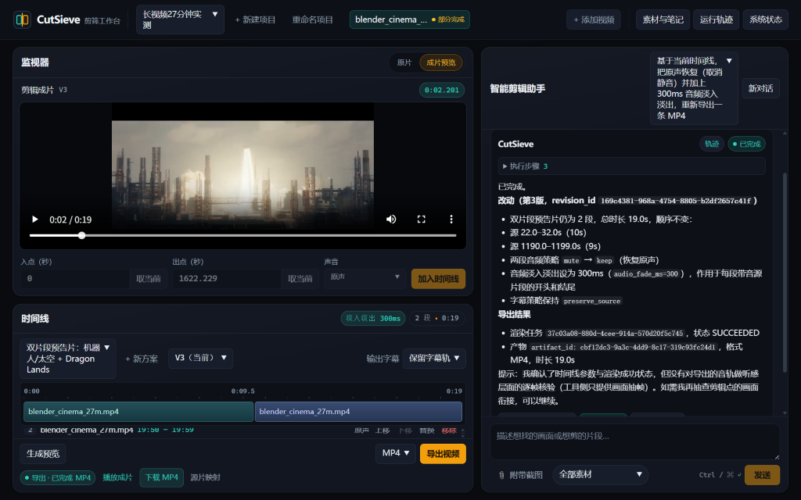
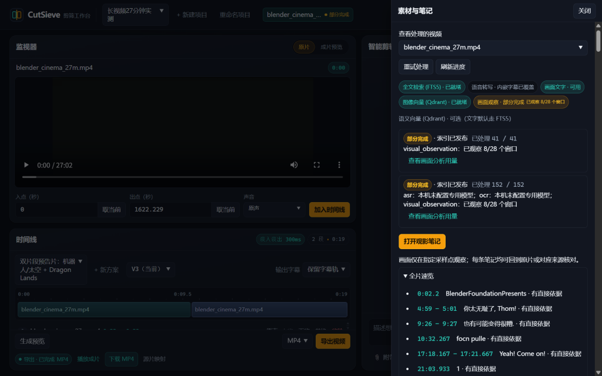
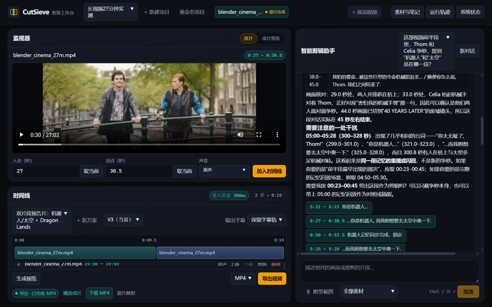
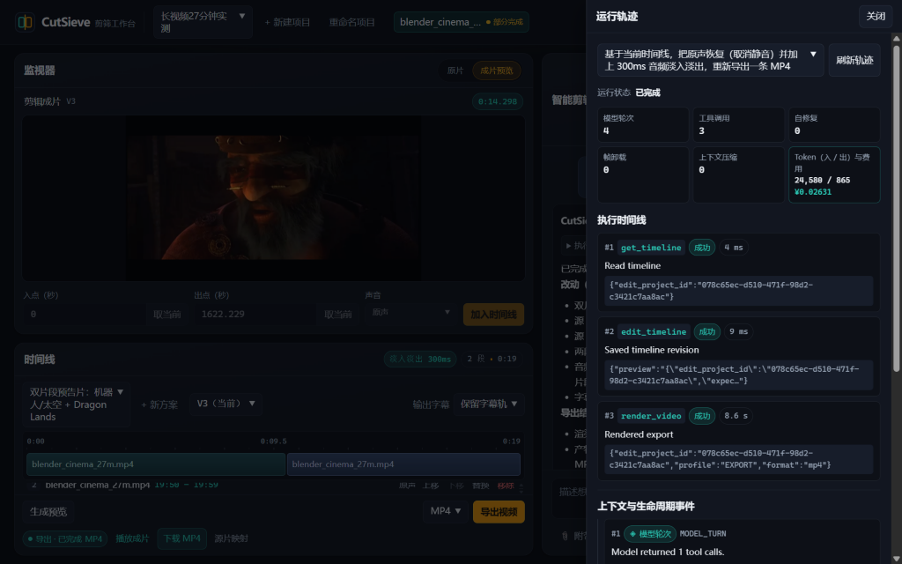
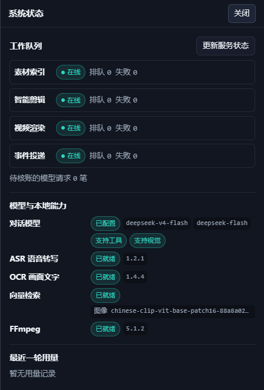

# CutSieve · 剪筛工作台

**本地优先的长视频多模态查证与可控粗剪 Agent 工作台。**

CutSieve 面向 **30 分钟以上的长原片**（电影拉片、纪录片粗剪、访谈与录屏复盘）。原片留在本机，推荐的入库配置用 SQLite FTS5 检索台词和画面文字，用 Chinese-CLIP 检索静默画面。**Agent Harness** 实现跨时段证据检索、原帧核实、版本化粗剪与 FFmpeg 验收导出，并在 **Harness Trace** 中记录工具调用、帧卸载、上下文压缩与耗时。



---

## 完整执行流程实录（27 分钟电影真片测试）

以下截图全部采集自本地运行的真实 **27 分 02 秒**双电影测试片（`blender_cinema_27m.mp4`，338.9 MB，前半段 *Tears of Steel* 中文字幕 + 后半段 *Sintel* 英文字幕），由 `deepseek-v4-flash` + 本地 FFmpeg 端到端执行。

### 1. 长片入库、覆盖记账与时间码观影笔记
上传后执行分片续传、FFprobe PTS 校准、160px 镜头边界自适应抽帧 + 静止帧去重、字幕/离线 Whisper 转写与 SQLite FTS5 建库；覆盖账本如实标注每个模态的处理进度，并生成覆盖 `0:00–27:02` 的可回溯观影笔记。



### 2. 跨片证据查证、排雷干扰片段与原片定位回看
提问“前半段 Thom 和 Celia 争吵提到‘机器人/太空’在哪一段”时，Agent 先检索台词再调 `inspect_frames` 核对画面细节（29.0s 桥上争吵、33.0s 机械手臂、44.0s 切镜废墟），**主动排雷 05:00–05:28 的回忆闪回干扰项**；点击任意引用胶囊（如 `0:27 – 0:30.5`），左上角原片监视器直接精准跳转到对应帧并自动填好入出点。



### 3. 版本化粗剪、淡入淡出导出与 Harness Trace 审计
支持在同一条时间线上多轮迭代（`V1` 跨片双片段 MP4 → `V2` 静音解说底片 WebM → `V3` 恢复原声 + `300ms` 音频淡入淡出 MP4，带 `expected_revision` 乐观锁与一键回滚）。打开右上角 **「运行轨迹」** 抽屉即可审计本轮的 6 项核心 KPI、每步工具参数与毫秒级耗时、自修复标记及 `MODEL_TURN` / `IMAGE_UNLOAD` / `COMPACTION` / `RENDER_WAIT` 生命周期事件。



---

## 本地感知服务状态

「系统状态」抽屉显示对话模型配置、后台队列，以及本机 ASR、OCR、Chinese-CLIP 向量检索与 FFmpeg 的就绪状态。



---

## Agent Harness 核心设计

CutSieve 不把长视频硬塞进大模型上下文，也不做脆弱的固定脚本流水线，而是围绕可控、可审计、低成本构建了完整的 **Agent Harness**：

- **单循环原生工具调用**：8 个正交工具（`get_media_overview`、`search_evidence`、`read_transcript`、`inspect_frames`、`get_timeline`、`edit_timeline`、`render_video`、`ask_user`）配合极简规则文档驱动，检查点持久化到 SQLite，支持重启续跑与异步渲染挂起/唤醒（`WAITING_JOB`）。
- **上下文工程（防长程 Token 膨胀）**：
  - **历史视觉帧自动卸载**：每轮调用模型前，自动将前序工具轮次的 `image_url` 卸载为带时间戳的文本摘要，仅保留当前轮视觉帧与用户上传查询图。
  - **原子事务历史压缩**：消息数或字符数触达阈值时，在不拆散 `assistant(tool_calls)` 与对应 `tool` 回执的前提下压缩中段历史，记录 `IMAGE_UNLOAD` / `COMPACTION` 事件。
  - **多帧拼图核验（Contact Sheet）**：`inspect_frames(..., contact_sheet=True)` 可将最多 6 帧拼成带 `MM:SS.s` 时间码角标的 1 张图，以 1 个图片槽位完成多切点核验。
- **确定性工具契约与自修复**：
  - `edit_timeline` 支持 `asset_id` / `media_revision_id` 自动解析、乐观锁防并发覆盖、`audio_fade_ms`（FFmpeg `afade` 首尾淡入淡出）与完整解码验收；
  - 任何校验/冲突报错都在工具回执中附带实时 `valid_assets`、`head_revision_no` 与 `current_clips`，引导模型 1 步自修复并标记 `SELF_REPAIR`。
- **本地长视频感知底座**：
  - **160px FFmpeg 镜头边界自适应采样**：替代固定 60 秒截断窗口，短镜取中点避开转场模糊帧、长镜保底采样 + 8×8 RGB 静止去重。
  - **持久化 SQLite FTS5 全文索引**：支持中文二元分词 + 英文词法检索（零 Alembic 迁移漂移），离线评测平均检索延迟 **6.2 ms**。
  - **本地多模态入库**：优先使用内嵌字幕，并用 Faster-Whisper 补齐无字幕语音、用 RapidOCR 读取画面文字、用 Chinese-CLIP 为代表帧建立跨模态索引。

---

## 为什么默认用 FTS5 + ASR + OCR + Chinese-CLIP，而不默认常驻 BGE-M3 文字向量？

| 要查找的证据 | 默认本地路径 | 工程依据 |
| --- | --- | --- |
| 台词、转写和观影笔记中的线索 | **SQLite FTS5 + Agentic Search** | 单片通常只有 **100–2,000 行**台词或文本片段。Agent 根据观影笔记和检索结果改写关键词、补同义词，FTS5 执行中英文词法召回，离线评测平均 **6.2 ms**。 |
| 无字幕的语音 | **`faster-whisper`，int8 CPU** | 在 `.venv` 内离线转写带时间戳的语音片段，随后进入 FTS5 和观影笔记。 |
| 幻灯片、硬字幕和界面报错 | **RapidOCR，ONNX PP-OCRv4** | `rapidocr-onnxruntime` 在 `.venv` 内读取采样帧文字，为 FTS5 提供音轨和软字幕之外的证据。 |
| 完全静默的场景 | **512 维 Chinese-CLIP + 嵌入式 Qdrant** | 自然语言可以直接检索代表帧。`qdrant-client` 在进程内读写索引，单片样例约 **471 KB**，无需 Docker。 |

CPU 常驻 BGE-M3 需要约 **2.27 GB** 的权重和约 **3 GB** 的内存。推荐配置把这部分容量留给语音、画面文字和视觉召回。数百小时以上的片库可按需启用独立的 BGE-M3 文本空间。

---

## 系统架构

```text
Vue 3 单屏暗房工作台（监视器 / 版本化时间线 / 对话助手 / 运行轨迹抽屉）
                            │ HTTP + SSE
                            ▼
FastAPI 单进程引擎（SQLite WAL + FTS5 + 本地磁盘 + 嵌入式 Qdrant）
  ├─ 长片入库流水线：分片续传 → FFprobe PTS 校准 → 160px 镜头检测与静止去重抽帧
  │                  → 内嵌字幕 / Faster-Whisper ASR / RapidOCR → FTS5 & 观影笔记
  │                  → Chinese-CLIP 代表帧编码 → 嵌入式 Qdrant
  ├─ 多路混合检索：SQLite FTS5 + 8×8 空间色彩/图像特征 + Chinese-CLIP 视觉召回（RRF 融合）
  └─ Native Tool-Use Agent Harness（默认 deepseek-v4-flash）
        ├─ 8 个正交工具 + Contact Sheet 拼图抽帧 + 自引导错误回执
        ├─ 上下文工程：历史视觉帧自动卸载 + 原子历史压缩 + 步数/图片上限
        ├─ SQLite 检查点（租约恢复）+ 乐观锁版本化时间线 + FFmpeg 音频淡入淡出与解码验收
        └─ /v1/workflow-runs/{id}/harness 轨迹遥测 + 自动化离线/真片 Eval 套件
```

更多模块与状态机细节见 [系统架构说明](docs/ARCHITECTURE.md)。

---

## 实测评测数据（`scripts/eval_harness.py`）

### 1. 27 分钟真片 Live Eval（`blender_cinema_27m.mp4`, 338.9 MB, `deepseek-v4-flash`）

| 评测任务 | 耗时 | 模型 / 工具轮次 | 失败重试 | 帧卸载 | Input / Output Tokens | 估算费用 | 结果 |
| :--- | ---: | :---: | :---: | :---: | :---: | ---: | :---: |
| 1. 中文对白定位 + 5:00 闪回排雷 | `5.75 s` | 3 / 4 | 0 | 0 | 22,502 / 816 | ¥0.024 | PASS |
| 2. 15–23 分钟深区英文检索 (`dragon`/`Scales`) | `3.69 s` | 2 / 2 | 0 | 0 | 14,948 / 418 | ¥0.016 | PASS |
| 3. 跨片双片段 + 300ms 淡入淡出 + MP4 导出 | `11.61 s` | 5 / 6 | 0 | 1 | 39,248 / 1,223 | ¥0.042 | PASS |
| 4. 基于现版本静音精修 + WebM 导出 | `16.78 s` | 4 / 3 | 0 | 0 | 33,298 / 953 | ¥0.035 | PASS |
| **合计（4 轮连续实测）** | **`37.8 s`** | **14 / 15** | **0** | **1** | **109,996 / 3,410** | **¥0.117** | **4/4 PASS** |

> 对比引入帧卸载、FTS5 与自引导回执前的同片基线：4 任务总耗时由 `99.9 s` 降至 `37.8 s`（**提速 2.6×**），跨片粗剪步的 Input Token 由 `70,156` 降至 `39,248`（**-44%**），`edit_timeline` 首次成功率由 `33%` 提升至 `100%`。

### 2. 离线确定性回归 Eval（`--mode offline`，0 API 费用）

| 离线验收项 | 实测结果 | 状态 |
| :--- | :--- | :---: |
| SQLite FTS5 中英文混合检索 | 5/5 Top-1 命中，平均耗时 **6.2 ms** | PASS |
| 镜头边界自适应采样 + 静止尾段去重 | 8 个镜头精确取 8 帧，静止段自动去重 | PASS |
| `edit_timeline` 报错自引导恢复 | 1 轮自修复完成 2 片段时间线建版 | PASS |
| 拼图抽帧 + 帧卸载 + 上下文压缩 | 2 帧合 1 图，触发 1 次卸载 / 3 次压缩，末轮省 886 Tokens | PASS |
| FFmpeg 300ms 音频淡入淡出与解码验收 | 全量解码验证四处淡入淡出边界包络 | PASS |

---

## 本地启动

前置依赖：**Python 3.12+**、**Node.js 22.12+**、PATH 中的 **FFmpeg / ffprobe**（或通过 `.env` 的 `CUTSIEVE_FFMPEG_DIR` 指定）。

### 1. 配置与启动后端

复制 `.env.example` 为根目录 `.env`，填入支持原生 `tools` 与工具消息 `image_url` 的模型配置（默认适配 `deepseek-v4-flash`）：

```powershell
git clone https://github.com/chauqaguno-design/CutSieve.git
cd CutSieve
py -3.12 -m venv .venv
.\.venv\Scripts\python.exe -m pip install -c constraints-py312.txt -e ".[test]"
.\.venv\Scripts\python.exe -m uvicorn cutsieve.presentation.api.app:create_app --factory --host 127.0.0.1 --port 8173 --workers 1
```

上述命令即可使用内置 FTS5。推荐按 [本地快速开始](docs/QUICK_START.md#2-配置本地感知) 配置 Faster-Whisper、RapidOCR 和仅启用 `vision` 空间的 Chinese-CLIP，再启动后端。

### 2. 启动前端

```powershell
cd client
npm ci
$env:CUTSIEVE_DEV_PROXY_TARGET = 'http://127.0.0.1:8173'
npm run dev -- --host 127.0.0.1 --port 5175
```

浏览器打开 `http://127.0.0.1:5175/` 即可进入工作台，点击「系统状态」确认本地服务就绪。

---

## 测试与自动化评测

```powershell
# 后端全量测试与 Alembic 零漂移校验
.\.venv\Scripts\python.exe -m pytest -q
$env:CUTSIEVE_DATABASE_URL = "sqlite:///work/verify-$([guid]::NewGuid()).db"
.\.venv\Scripts\python.exe -m alembic upgrade head
.\.venv\Scripts\python.exe -m alembic check

# Harness 自动化评测（离线 0 费 / 真片实测）
.\.venv\Scripts\python.exe scripts/eval_harness.py --mode offline
.\.venv\Scripts\python.exe scripts/eval_harness.py --mode live --video work/samples/blender_cinema_27m.mp4

# 前端单测、组件测试与生产构建
cd client
npm test
npm run build
```

---

## 适用边界与诚实定位

- **CutSieve 擅长的事**：30 分钟以上本地长原片的声画交叉查证、干扰片段排雷、原片时间码回溯核实、多轮可回滚粗剪（含淡入淡出与静音底片）以及原片不出本地的低成本处理。
- **CutSieve 刻意不做的事**：不竞争剪映/OpusClip 的“一键爆款抖音花字 + BGM 卡点包装”，也不竞争达芬奇/WeftCut 的多轨关键帧调色与复杂视觉特效合成；无模型配置时，上传、索引检索、手动粗剪与 FFmpeg 导出仍可独立使用。

## 许可

本项目基于 [MIT License](LICENSE) 开源。
